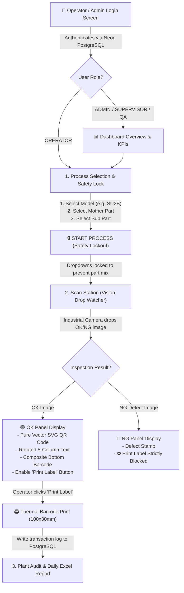

# HSI Auto Industrial MES Verifier: System Flow & RBAC Architecture Guide

An enterprise-grade reference manual detailing the **Role-Based Access Control (RBAC)** security architecture and the **End-to-End Operational Lifecycle** of the HSI Auto Barcode Verification & 100×30mm Label Printing Suite.

---

## 1. Role-Based Access Control (RBAC) Matrix

The system enforces strict shopfloor separation of duties across **4 distinct industrial roles**. Each role has defined boundaries to prevent part mixing, unauthorized recipe edits, or accidental credential modifications.

### 1.1 Complete Permissions Matrix

| Industrial MES Module / Page | `OPERATOR` | `SUPERVISOR` | `QUALITY_INSPECTOR` | `ADMIN` |
| :--- | :---: | :---: | :---: | :---: |
| **1. Process Selection & Lock** | ✅ **Select & Lock** | ✅ **Full Control** | 👁️ **Inspection Only** | ✅ **Full Control** |
| **2. Scan Station (100×30 Print)** | ✅ **Primary Operator** | ✅ **Full Access** | ✅ **Defect Validation** | ✅ **Full Access** |
| **3. Dashboard Overview & KPIs** | ⛔ **Restricted (Hidden)** | ✅ **Full Access** | ✅ **View Analytics** | ✅ **Full Access** |
| **4. Production Reports & Excel** | ⛔ **Restricted (Hidden)** | ✅ **Shift Reports** | ✅ **Defect Export** | ✅ **Download Excel** |
| **5. Master Data Management** | ⛔ **Restricted (Hidden)** | 👁️ **View Only** | 👁️ **View Only** | ✅ **Ingest & Edit** |
| **6. User Accounts & Admin** | ⛔ **Restricted (Hidden)** | ⛔ **Restricted (Hidden)** | ⛔ **Restricted (Hidden)** | ✅ **Full Control** |

---

### 1.2 Deep Dive: Role Descriptions & Restrictions

#### 👷 1. OPERATOR (`OPERATOR`)
* **Role Purpose**: Shopfloor line technicians operating the assembly bench and thermal printer.
* **Allowed Modules**:
  - **Process Selection**: Can select Vehicle Model, Mother Part No, Sub Part No, and click **START PROCESS** to lock specifications.
  - **Scan Station**: Select drop folder, trigger camera scan, preview OK/NG parts, and print thermal 100×30mm barcodes.
* **Restricted Modules**:
  - ❌ **Dashboard**: Hidden to keep operator screen focused purely on production without KPI distractions.
  - ❌ **Reports**: Cannot access or download plant audit trails.
  - ❌ **Master Data**: Cannot view or modify part engineering databases.
  - ❌ **Administration**: Cannot create accounts or change passwords.
* **Landing Page**: Automatically redirects to **Process Selection** upon login.

#### 🛡️ 2. SUPERVISOR (`SUPERVISOR`)
* **Role Purpose**: Production shift in-charge responsible for line targets, hourly throughput, and shift handover.
* **Allowed Modules**:
  - **Dashboard**: Full visibility into live shift targets, OK/NG counters, hourly verification rates, and plant audit table.
  - **Process Selection & Scan Station**: Full control to override locks or assist operators.
  - **Production Reports**: Generates and downloads shift summary reports.
  - **Master Data**: **View-Only Mode**. Can browse and search the part catalog, but cannot delete or upload new Excel sheets.
* **Restricted Modules**:
  - ❌ **Administration**: Cannot add/edit users or alter role assignments.

#### 🔍 3. QUALITY INSPECTOR (`QUALITY_INSPECTOR`)
* **Role Purpose**: Quality Assurance (QA) engineer responsible for root-cause defect analysis and visual inspection audits.
* **Allowed Modules**:
  - **Dashboard**: Analytics view for defect rates (NG parts vs OK parts).
  - **Process Selection**: Read-only verification of target ALC codes and drawing specifications.
  - **Scan Station**: Defect validation on camera inspection drops; audits rejected items.
  - **Production Reports**: Defect logs export for plant quality review meetings.
  - **Master Data**: **View-Only Mode** to cross-verify engineering specs against physical parts.
* **Restricted Modules**:
  - ❌ **Administration**: Cannot modify system users.

#### 👑 4. SYSTEM ADMINISTRATOR (`ADMIN`)
* **Role Purpose**: Plant MES administrator and IT operations head.
* **Allowed Modules**:
  - **Full Unrestricted Access** across all 6 modules:
    - Ingests new Excel master part files (`.xlsx`, `.xls`, `.csv`).
    - Creates, updates, resets passwords, and deletes system user accounts.
    - Configures plant line assignments (`Line 1`, `Line 2`, `Line 3`, `All Lines`) and work shifts (`Shift 1`, `Shift 2`, `Shift 3`, `All Shifts`).
    - Resets shift counters when initiating new plant production runs.

---

### 1.3 Pre-Configured Test Credentials

| Role | Username | Password | Default Assignment | Scope |
| :--- | :--- | :--- | :--- | :--- |
| **ADMIN** | `admin` | `Admin@123` | All Lines • All Shifts | Full System MES Control |
| **OPERATOR** | `operator` | `Operator@123` | Line 2 • Shift 1 | Process Selection & Scan Station |
| **SUPERVISOR** | `supervisor` | `Super@123` | Line 2 • Shift 2 | Dashboard, Reports & Masters (View Only) |
| **QUALITY QA** | `quality` | `Quality@123` | Line 1 • Shift 1 | Defect Analytics & QA Review |

---

## 2. End-to-End Operational Workflow



---

### Step-by-Step Production Stages

### Stage 1: Authentication & Safety Login
1. When opening or reloading the application, the system presents the **Login Page**.
2. The user enters credentials or clicks one of the **4 Quick-Access Role Chips**.
3. Credentials are authenticated against the `system_users` table in Neon PostgreSQL.
4. Role permissions are applied immediately:
   - Operators land directly on **Process Selection** with unauthorized tabs hidden.
   - Supervisors and Admins land on the **Dashboard Overview**.

---

### Stage 2: Master Data Management (Admin Stage)
1. The Administrator uploads the official plant Excel spreadsheet (e.g., `VACUUM HOSE PART LIST.xlsx`).
2. The backend parser extracts and indexes:
   - `MODEL NO` (e.g., `SU2B`, `BC4B`, `MQ4I`, `BC4I`, `DN7I`, `AI3`)
   - `PART NAME` (e.g., `VACUUM HOSE`)
   - `PART NO` (e.g., `59130BX350`, `59130BX400`, `59130BP000`)
   - `SUB PART NO`
   - `ALC CODE` (e.g., `VH30`, `VH95`, `VH45`, `VH25`)
   - `SL NO` & Technical Specifications.
3. Master data is stored persistently in Neon PostgreSQL (`master_parts` table).

---

### Stage 3: Process Selection & Safety Lockout
1. The operator selects the **Vehicle Model** (e.g., `SU2B`).
2. The **Mother Part No** dropdown automatically populates with all valid parts for that model.
3. The **Sub Part No** dropdown dynamically filters matching variants.
4. The system auto-loads and displays:
   - Mother Part No, Clean Part No, Part Name, Target ALC Code, E.O. Number, Supplier Code, and Serial No.
5. The operator clicks **"START PROCESS"**:
   - All dropdowns become **locked/disabled** to prevent wrong part mixing during the assembly run.
   - The station status changes to `LOCKED & READY`.

---

### Stage 4: Vision Scan Station & Inspection Watcher
1. The operator sets the inspection drop folder (e.g. `C:\Inspection\DropZone`).
2. The background watcher continuously scans the folder (every 3.5 seconds) or on manual trigger:
   - Approved parts are routed to the **OK Images Panel**.
   - Defective parts are routed to the **Not OK (NG) Images Panel**.
3. **NG Protection**: If a part fails camera inspection, label printing is **strictly blocked** to prevent unverified components from entering the supply chain.

---

### Stage 5: 100×30mm Thermal Label Generation & Printing
For every OK inspected component, the system dynamically formats a 100×30mm industrial label:
1. **Left Rotated Section (5 Columns, 90° orientation)**:
   - `SL NO` • `MODEL` • `PART NO` • `PART NAME` • `ALC CODE`
2. **Bottom Composite Barcode**:
   - Formatted industrial string (e.g. `T05APRT1234510001ATPL500ALC9876`).
3. **Right 2D Vector QR Code**:
   - Rendered using pure native vector SVG `<path>` elements, guaranteeing crisp scanability at high DPI without raster blurring.
   - Batch Code (e.g. `P587T000`).
4. Thermal label can be printed directly using standard thermal barcode printers (100mm × 30mm media size).

---

### Stage 6: Audit Trail & Excel Reporting
1. Every scan and label print creates an immutable audit record in PostgreSQL (`logs` and `label_logs` tables).
2. Supervisors and Admins can export the **Daily Production Report (`.xlsx`)** with a single click, detailing:
   - Timestamp, Part No, Sub Part No, Model, ALC Code, Shift, Operator, Print Status, and Inspection Result.

---

## 3. Technology & Cloud Architecture

```text
┌─────────────────────────────────────────────────────────────────┐
│                    CLIENT BROWSER (Vercel / Render)             │
│  React 18 + Vite (SPA)                                          │
│  - RBAC Navigation Guards & Access Control Matrix               │
│  - Pure Native Vector SVG QR Generator                          │
│  - Dynamic 100x30mm Thermal Print Engine                        │
└────────────────────────────────┬────────────────────────────────┘
                                 │ REST API Calls (VITE_API_URL)
                                 ▼
┌─────────────────────────────────────────────────────────────────┐
│                 BACKEND SERVICE (Render Web Service)            │
│  Node.js + Express Server                                       │
│  - Dynamic Port Binding (process.env.PORT)                      │
│  - Folder Watcher & Image Classification                        │
│  - Excel Ingestion Engine (xlsx)                                │
│  - Session & User Authentication (/api/auth/login)              │
└────────────────────────────────┬────────────────────────────────┘
                                 │ SSL Encrypted Pool Connection
                                 ▼
┌─────────────────────────────────────────────────────────────────┐
│                 DATABASE (Neon Serverless PostgreSQL)           │
│  - master_parts: Catalogs, vehicle models, ALC specs            │
│  - system_users: Hashed credentials, line/shift assignments    │
│  - logs: OK/NG camera verification records                      │
│  - label_logs: Barcode print transactions & plant audit history │
└─────────────────────────────────────────────────────────────────┘
```
